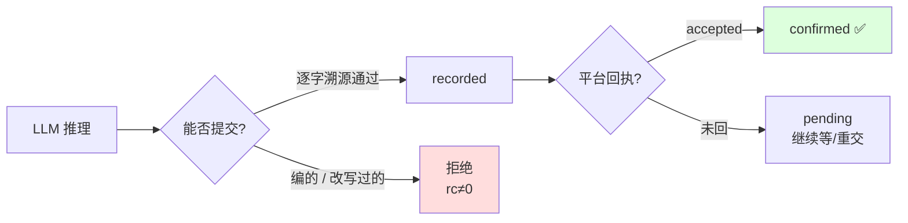

# PiCTF

**让 LLM agent 按纪律解 CTF 题 —— 不靠模型自述成功，靠机器判据。**

[](https://github.com/baoan778/baoanCTF/actions/workflows/ci.yml)
[](LICENSE)
[](https://www.python.org/)
[](.github/workflows/ci.yml)

---

## 它解决什么

LLM 解 CTF 有三个绕不过去的毛病：

| 毛病 | 后果 | PiCTF 的做法 |
|---|---|---|
| **模型会编 flag** | 交上去是假的，浪费提交次数 | `fgs verify`：flag 必须在原始输出里**逐字**出现过。纯代码比对，**没有 LLM 参与** |
| **agent 原地打转** | 同一招试 20 次，烧光预算 | `reflect`：回放会话，判「同方法 / 该换面 / 缺工具 / 过滤器封死」，给出下一步 |
| **长任务丢上下文** | 压缩一次，前面全白干 | 黑板落盘**事实**与**已证伪路线**；`handoff-card` 生成 ≤60 行交接卡 |

> 一句话：把「靠自觉」换成「靠判据」。

---

## 三道机器闸门



1. **置信度分级** —— `verified` / `unverified` / `inferred`，**只有 verified 能授权 solved**；且依据的事实必须挂在图上，孤点不算数。
2. **Worker 不能直接写图** —— 只能 publish 到 outbox，主会话校验后合入。一条不合法 → **整批拒绝**。
3. **平台回执才算确认** —— agent 自称成功、HTTP 200、退出码 0、格式看着对，**都不是证据**。

---

## 快速开始

### 1. 装 pi 运行时（一次性）

本仓库**不 vendored** pi（省 167MB），按标准 npm 方式装：

```bash
npm i -g @earendil-works/pi-coding-agent --registry=https://registry.npmmirror.com
pi --version      # 应输出 1.5.x
```

> 没有 npm？先装 Node 22+。装好后 `tools/bin/pi` 会自动找到它（系统 PATH → 全局 npm → 包内 vendor 三级回退）。

### 2. 起容器

```bash
bash deploy.sh          # Linux / macOS / WSL / Git-Bash
```

Windows 双击 **`部署.bat`**。

脚本做五件事，**幂等可反复跑**：

```
查 Docker → 查 .env（缺就生成并指出填哪行）
         → 构建镜像（已存在则跳过）
         → 启动 → 等健康检查 → 打印地址
```

```bash
bash deploy.sh --fast      # 跳过构建
bash deploy.sh --rebuild   # 强制重建
bash deploy.sh --status    # 只看状态
```

### 3. 开始用

浏览器打开 **http://127.0.0.1:30142/** ，或进容器用终端：

```bash
docker exec -it pictf bash
fgs kickoff my-first-ctf --kind ctf --goal "拿到 flag"
```

---

### 资源要求

| 项 | 要求 |
|---|---|
| 磁盘 | **~25 GB**（镜像 13.5GB + 构建缓存） |
| 内存 | 建议 **8 GB+**（ghidra / sage 吃内存） |
| 首次耗时 | 20~40 分钟（构建镜像，**只需一次**） |

> **为什么首次要构建**：镜像内含全套 CTF 工具链（nmap / sqlmap / ghidra / sage / radare2 / john / hashcat …）。
> 之后改代码**不用重建** —— `board/` `tools/` 是 bind mount，改完直接生效。

### 只想跑本地工具链（不要容器）

```bash
./install.sh                        # apt + pip（已配国内镜像）
bash tools/bin/selfcheck --quick    # 自检，约 10s
```

Windows 用户见 [README-部署.md](https://github.com/baoan778/baoanCTF/blob/master/README-%E9%83%A8%E7%BD%B2.md) —— 里面有 **Docker vs WSL 原生** 的对照表（磁盘 25GB vs 2.5GB）。

---

## 实测数据

这些数字都可以自己复现（`bash tools/bin/selfcheck`）：

| 项 | 数量 |
|---|---|
| 回归测试 | **151 条**（CI 双平台全绿）— 唯一事实来源是 `python3 tools/testcount.py` |
| 黑板内核 | `board/fgs.py` **11,316 行**，**零第三方依赖**（纯 stdlib） |
| 命令入口 | **118** 个（`tools/bin/`） |
| 知识库 | 索引后 **3 万+ 块**（PoC / WP / 参考 / 笔记），带 `文件:行号` 指针 |
| CTF 技能 | **17** 个题型方法论 |
| 角色注册表 | **10** 个 CTF 角色 + 模型路由 |

> 知识库索引是**派生物**，不在仓库里。`kb build` 扫本地 `tools/knowledge/` 生成
> （本机实测 610 个文件 → 31,169 块，13.8 秒），所以「多少块」取决于你放进去多少资料。

---

## 核心命令

| 命令 | 作用 |
|---|---|
| `fgs kickoff <pid> --kind ctf --goal "..."` | 建黑板 + 立目标 + 打印该派哪几路 |
| `fgs verify` / `gate` / `solved` / `confirm` | 逐字溯源 / 门禁 / 完成判定 / 平台回执 |
| `fgs cost` · `pending` · `snapshot` | 成本度量 / 待提交 flag / 状态快照 |
| `reflect <pid>` | 会话回放 → 四类判定 + 下一步建议 |
| `handoff-card` | 生成 ≤60 行交接卡（替代整读状态快照） |
| `kb search "<词>"` | 知识库检索（3 万+ 块，带 `文件:行号` 指针） |
| `selfcheck` | 全套自检（`--quick` 约 10s / 全量约 3min） |

完整清单 → [`tools/TOOLS.md`](tools/TOOLS.md)（唯一事实来源）。

---

## 目录结构

```
board/            黑板内核 fgs.py（11k 行，纯 stdlib）+ 回归测试
tools/            工具链 118 个入口 + 知识库（31k 块）
skills/           17 个 CTF 题型方法论
agent-template/   10 个角色注册表 + 模型路由
docker/           容器镜像（全套 CTF 工具预装）
docs/             架构 / 纪律 / 分工 / 并行与竞赛打法（7 篇）
```

---

## 设计纪律（踩过的坑）

这个项目最值钱的部分不是代码，是**踩出来的判据**。三条都写在
[`docs/经验-工程纪律.md`](docs/经验-工程纪律.md)：

| 纪律 | 血账 |
|---|---|
| **§4b 新判据必须先在历史数据上回放** | 一条判据 23 条**合成**断言全绿 → 拿 104 题真实会话回放，**7 命中、4 误判** |
| **§4c 环境故障与业务失败必须分流** | 检查器把「自己站不稳」误报成「对象有问题」，是头号时间黑洞 —— **噪声闸门的下场是被关掉** |
| **§4d 基线断言必须绑冻结快照** | 同一个病两周犯两次：断言绑在活账本上，真跑几道题就红。放宽阈值是治标 |

---

## 文档地图

| 想知道 | 读 |
|---|---|
| 架构与来历 | [`docs/架构设计.md`](docs/架构设计.md) |
| 工程纪律（**踩过的坑**） | [`docs/经验-工程纪律.md`](docs/经验-工程纪律.md) |
| 黑板契约 | [`board/schema.md`](board/schema.md) |
| 交接卡与判据 | [`docs/交接卡-模板.md`](docs/交接卡-模板.md) |

---

## 已知边界

- **不做 SRC 挖洞 / 渗透 / 应急响应** —— 那三类归其他工具（见 [`docs/分工-与dsh.md`](docs/分工-与dsh.md)）。
- **`tools/knowledge/`** 是公开 writeup 检索库，版权归原作者，**不适用本仓库 MIT**。
- **`vendor/`** 是第三方副本，不随本仓库许可（详见 [NOTICE](NOTICE)）。
- 首次构建需要 **25GB 磁盘**，这是 13.5GB 工具链的硬成本。

---

## 贡献

见 [CONTRIBUTING.md](CONTRIBUTING.md)。三条硬规矩：

> **新判据必须先在历史数据上回放** · **环境故障与业务失败必须分流** · **改完跑全套**

不接受：大重构 / 纯格式化 / 重依赖 / 把判据改成信模型。

## 安全

发现安全问题请走 [SECURITY.md](SECURITY.md)，**不要开公开 issue**。

## 许可

[MIT](LICENSE) © 2026 [baoan778](https://github.com/baoan778) · 第三方组件见 [NOTICE](NOTICE)
